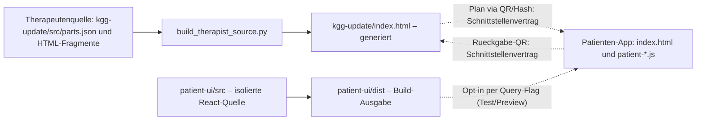
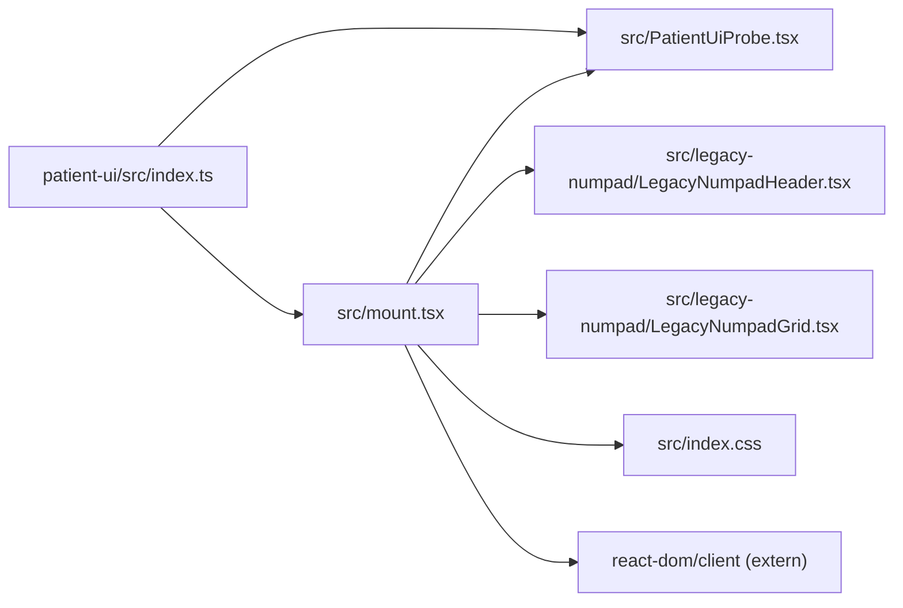

# KGG – Architektur sichtbar machen (begrenzter Pilot)

**Quellstand:** `main` `58edea846ebe82d4df45991a22b69f7972e5a77e` vom 26.10.2026. **Art:** lesbare, versionierte Architekturdokumentation; kein Laufzeit- oder Release-Änderungspfad.

## 1. Quellbereiche und dokumentierte Schnittstellen

**Bedeutung der Kanten:** Durchgezogen = im Quell-/Buildvertrag ausdrücklich beschrieben. Gestrichelt = dokumentierter Daten- bzw. optionaler Integrationsvertrag, **kein** hier ausgeführter Ende-zu-Ende-Laufzeittest.

- Therapeut:innen: [Quellmanifest](../../kgg-update/src/parts.json), [Build-Script](../../release-pipeline/build_therapist_source.py), [Source-README](../../kgg-update/src/README.md). `kgg-update/index.html` ist generiert und darf nicht direkt gepatcht werden.
- Patient:innen: [APP_BOUNDARIES.md](../../APP_BOUNDARIES.md), [Patienten-Laufzeit](../../index.html). `KGGDataStore.currentPlan` bleibt die bestehende zentrale Planquelle der Therapeut:innen-App; die React-Insel ist **keine** neue Plan-State-Quelle.
- React-Opt-in: [patient-ui/README.md](../../patient-ui/README.md), [package.json](../../patient-ui/package.json). P7/P8 sind testweise optional; sie übernehmen keinen eigenen LocalStorage-, QR-, Scan- oder Plan-State. Ob die Opt-in-Assets im konkreten Browserstand geladen werden, wurde hier nicht ausgeführt.
- Das gesonderte [Bereitstellungs-Repository](https://github.com/Kayus24/patienten-info-app) ist nicht der Nachweis einer vollständigen zweiten Implementierung.

## 2. Nachweisbare direkte React-Quellimporte (bewusst nur ein Ausschnitt)

Diese Kanten sind aus den konkreten [Exports in index.ts](../../patient-ui/src/index.ts) und [Imports in mount.tsx](../../patient-ui/src/mount.tsx) ablesbar. Sie sind **kein** vollständiger Abhängigkeitsgraph: weitere Komponentenimporte, CSS-Importe, globale DOM-Aufrufe, Laufzeitskripte, dynamische Script-Injektion und QR-Datenflüsse sind hier nicht vollständig erfasst.

## 3. So nutzen Codex oder Claude die Übersicht

Bei einer Änderung zuerst die betroffene **Quell- statt Ausgabedatei** identifizieren, dann an den eingezeichneten Grenzen prüfen, ob ein Datenvertrag, eine React-Opt-in-Insel oder nur ein lokaler Import betroffen ist. Anschließend immer den tatsächlichen Code und die bestehenden KGG-Gates prüfen; eine Diagrammkante beweist keinen Funktionstest. Nicht alle historischen Releaseartefakte oder andere Projekte nachträglich indizieren.

**Automatisierte Analyse:** `dependency-cruiser` kann später für die statischen JS-/TS-Importe auf einem offiziell unterstützten Node-LTS-Stand einen Mermaid-Graphen erzeugen. Auf dem geprüften Rechner läuft derzeit Node **25.8.0**; die [geprüfte v18-Linie](https://github.com/sverweij/dependency-cruiser/blob/main/doc/cli.md) nennt `^22 || ^24 || >=26`. Daher im Pilot **nicht installiert**, kein `npm install`, kein neues CI-Gate und keine Lockfile-Änderung. Vor einer späteren Aufnahme Version/Node, Paketfolgen und Graphqualität getrennt messen.

**Grenzen:** Kein Screenshot-/Video-Generator, keine vollständige Datenfluss-, Laufzeit- oder Sicherheitsanalyse. Keine Aussagen über produktive Flow-Synchronisierung oder Working-Motion-Bridge: Das ist ein separates, lokal begrenztes Projekt mit eigenen Freigaben.

**Prüfstatus:** Source-/Manifest-Abgleich erfolgt. Mermaid-Syntax, Dateiverweise, Hook und Diff werden vor dem PR separat kontrolliert; vollständige KGG-Batterie, echte Geräte- und Cloudtests sind für dieses reine Dokumentationsdelta nicht ausgeführt.
